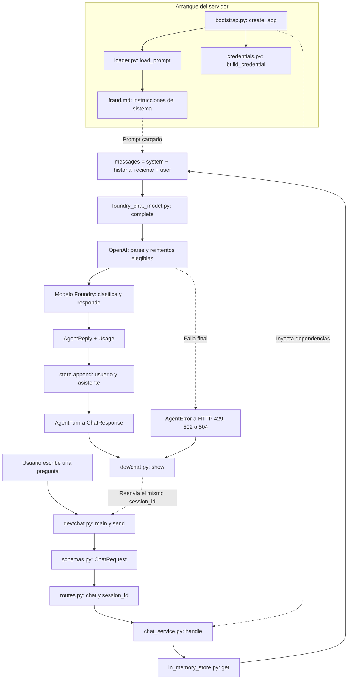

# Aprendizaje S2 - Lab: Servicio IA

Guía de lo aprendido en esta sesión: clases, intención, memoria, consumo, errores, logs y depuración del recorrido completo.

> Las líneas corresponden al código revisado al crear esta guía. Si agregas comentarios, pueden desplazarse: busca también la función indicada. Las etiquetas `#JP` son comentarios personales, no instrucciones que Python ejecute.

## 1. Lo más importante para el lab

1. **Cliente y servidor son procesos diferentes.** Ejecutar el cliente no levanta ni depura la API.
2. **El modelo real clasifica la intención.** Python prepara los mensajes y valida la respuesta; no compara palabras para decidirla.
3. **La memoria es historial en RAM por `session_id`.** No es aprendizaje permanente del modelo.
4. **El prompt del dominio se carga al arrancar.** `DOMAIN=fraud` selecciona el archivo de instrucciones.
5. **El contrato importa tanto como la respuesta.** Entrada validada, salida estructurada, consumo y errores HTTP forman parte del servicio.
6. **Los breakpoints detienen el servidor.** El cliente puede agotar sus 120 segundos mientras tú inspeccionas variables.
7. **Clasificar una acción no equivale a ejecutarla.** En esta versión no se bloquean tarjetas ni se consultan movimientos reales.

### Advertencia sobre el estado actual de la memoria

En [routes.py](src/agent/infrastructure/api/routes.py), línea 40, se pasa `session_id` a `ChatResponse`, pero la clase [ChatResponse](src/agent/infrastructure/api/schemas.py) actualmente **no declara ese campo**. Con la configuración actual de Pydantic, ese argumento extra se ignora.

El cliente [chat.py](dev/chat.py), línea 36, espera `reply["session_id"]`. Por tanto, el contrato actual rompe la continuidad de la conversación y puede provocar `KeyError: 'session_id'`.

Se confirmó con una prueba existente, sin llamar a Foundry:

```powershell
uv run pytest tests\infrastructure\test_api.py -q -k test_chat_keeps_session_id
```

Resultado: **1 prueba fallida**, `KeyError: 'session_id'` en [test_api.py](tests/infrastructure/test_api.py), línea 42. Esta guía no modifica ese código. El contrato esperado debe declarar `session_id: UUID` en la respuesta; hasta resolverlo, no des por verificada la memoria de punta a punta.

## 2. Resumen del historial de preguntas

| Pregunta o situación | Aprendizaje |
|---|---|
| ¿Qué hace cada clase y cuáles son sus parámetros importantes? | Separar contratos del dominio, caso de uso e implementaciones de infraestructura. Ver sección 3. |
| ¿Dónde se configura `out_of_scope` para fraude? | En las instrucciones de [fraud.md](src/agent/infrastructure/prompts/fraud.md), y como valor permitido de `Intent` en [models.py](src/agent/domain/models.py). No existe una respuesta de rechazo fija. |
| ¿Dónde está la memoria si digo “me llamo Juan”? | En `_sessions` de [in_memory_store.py](src/agent/infrastructure/persistence/in_memory_store.py); el historial vuelve a enviarse en cada turno. |
| ¿Cómo seguir desde mi pregunta hasta la respuesta? | Cliente → validación HTTP → ruta → caso de uso → historial → adaptador → modelo → consumo → almacenamiento → respuesta HTTP → consola. |
| `ConnectionRefusedError: WinError 10061` en el launcher de debugpy | Se intentó conectar a un adaptador de depuración que no estaba escuchando. No prueba un fallo del agente ni de Foundry. |
| “No hay agente en .../chat” | El cliente no encontró un servidor disponible; levantar primero Uvicorn y comprobar `/health`. |
| `No module named debugpy` | El entorno del proyecto no tenía ese paquete disponible entonces. Hoy figura en el grupo `dev` y se verificó la versión 1.8.22. |
| Solo tenía “Archivo actual” en la configuración | Si el archivo activo es el cliente, F5 depura únicamente ese proceso. Usar “Adjuntar al agente” para el servidor. |
| El chat responde pero no entra a los breakpoints | Ejecutar con `uv run` no adjunta un depurador; además puede existir otro servidor ejecutándose sin debug. |
| No sabía cómo adjuntar al agente | Servidor escuchando en 5678 con `--wait-for-client`; seleccionar la configuración de attach en VS Code y pulsar F5. |
| `TimeoutError: timed out` en el cliente | La espera HTTP de 120 segundos terminó. Un breakpoint o una llamada lenta con reintentos pueden explicarlo; el traceback solo no distingue ambas causas. |
| ¿Dónde se evalúa la intención? | En el modelo remoto, durante `chat.completions.parse(...)`; `message.parsed.intent` permite observar el resultado. |
| Quería un `console.log` de intención | En Python usamos `log.info`; muestra la intención final, no el razonamiento interno. |
| Quería ver el contenido de `messages` | Se agregó un log antes de la llamada: prompt del sistema, historial y mensaje nuevo. |
| No aparecían los nuevos logs | Un servidor sin recarga puede seguir usando código anterior. Reiniciar el proceso correcto; no se confirmó durante la sesión que los logs nuevos aparecieran en su terminal. |
| ¿Prompt del dominio + prompt del usuario determinan la intención? | Sí, junto con el historial y el esquema `AgentReply`. No son solamente dos entradas cuando ya existe conversación. |
| ¿Dónde se usa `Usage` y qué recibe? | El adaptador crea el objeto con modelo, llamadas, latencia y tokens; luego viaja hasta la API y la consola. |
| ¿`Usage` hereda o está parametrizado por Pydantic? | Hereda de `BaseModel`; los campos tipados se validan al instanciarlo con argumentos nombrados. |
| ¿Dónde dice que `AgentError` llega después de los retries? | Se configura `max_retries` en el cliente OpenAI y el SDK implementa los reintentos. La afirmación necesita matiz: no todos los errores son reintentables. Ver sección 8. |

## 3. Clases y parámetros que debes reconocer

| Clase / contrato | Qué hace | Parámetros o campos clave |
|---|---|---|
| `ChatService` en [chat_service.py](src/agent/application/chat_service.py) | Resuelve un turno, recupera memoria, llama al modelo y guarda los mensajes. Solo conoce puertos. | `model`, `store`, `system_prompt`, `max_turns`; `handle(session_id, message)`. |
| `ChatModel` en [ports.py](src/agent/domain/ports.py) | `Protocol` que define lo necesario para llamar a un modelo. | `complete(messages) -> ModelResult`. |
| `ConversationStore` en [ports.py](src/agent/domain/ports.py) | `Protocol` que define lectura y escritura del historial. | `get(session_id)` y `append(session_id, message)`. |
| `FoundryChatModel` en [foundry_chat_model.py](src/agent/infrastructure/llm/foundry_chat_model.py) | Implementa el puerto del modelo mediante el SDK OpenAI compatible con Foundry. | `endpoint`, `credential`, `deployment`, `timeout_s`, `max_retries`. |
| `InMemoryConversationStore` en [in_memory_store.py](src/agent/infrastructure/persistence/in_memory_store.py) | Guarda listas de mensajes en un diccionario RAM. | `_sessions`, clave `session_id`. |
| `Intent` en [models.py](src/agent/domain/models.py) | Enum de los cinco valores de intención permitidos; no clasifica por sí mismo. | `product_question`, `data_query`, `sensitive_action`, `greeting`, `out_of_scope`. |
| `AgentReply` en [models.py](src/agent/domain/models.py) | Salida estructurada del modelo, validada con Pydantic. Prohíbe campos extra y respuestas vacías. | `intent: Intent`, `answer: str`. |
| `Usage` en [models.py](src/agent/domain/models.py) | Registro de consumo y latencia. | `models`, `llm_calls`, `latency_ms`, `prompt_tokens`, `completion_tokens`. |
| `ModelResult` en [models.py](src/agent/domain/models.py) | Resultado que devuelve una llamada al adaptador. | `reply`, `usage`. |
| `AgentTurn` en [models.py](src/agent/domain/models.py) | Resultado del caso de uso para un turno. Hoy tiene los mismos campos que `ModelResult`, pero representa otra frontera. | `reply`, `usage`. |
| `ChatRequest` en [schemas.py](src/agent/infrastructure/api/schemas.py) | Valida el JSON de entrada antes de entrar a la ruta. | `message`: 1–2000 caracteres tras quitar espacios extremos; `session_id`: UUID opcional. |
| `ChatResponse` en [schemas.py](src/agent/infrastructure/api/schemas.py) | Define la salida HTTP. | Hoy: `intent`, `answer`, `usage`. Falta el `session_id` esperado por el cliente. |
| `ErrorKind`, `AgentError` en [errors.py](src/agent/domain/errors.py) | Categoría de error y excepción controlada con detalle. | `kind`, `detail`; `from error` conserva la causa original cuando se usa. |
| `ErrorResponse` en [schemas.py](src/agent/infrastructure/api/schemas.py) | JSON público de una falla controlada. | `error`, `detail`. |
| `Settings`, `FoundrySettings`, `AuthProvider` en [settings.py](src/agent/infrastructure/config/settings.py) | Leen configuración del entorno y del archivo `.env`. Seleccionan dominio y conexión. | `domain`, `max_turns`; `endpoint`, `auth_provider`, `api_key`, `deployment`, `timeout_s`, `max_retries`. |

**Arquitectura:** `infrastructure → application → domain`. El caso de uso no depende directamente de FastAPI, OpenAI ni del diccionario en RAM.

## 4. Flujo completo y diagrama

### 4.1 Arranque: ocurre antes del primer mensaje

1. Uvicorn ejecuta [create_app](src/agent/infrastructure/bootstrap.py), línea 38, por `--factory`.
2. Se crea `Settings` y, si no se inyectó un modelo, [build_chat_model](src/agent/infrastructure/bootstrap.py), línea 24, construye el adaptador.
3. [build_credential](src/agent/infrastructure/llm/credentials.py), línea 14, selecciona API key o proveedor de token Entra ID. El proveedor puede obtener el token al realizar la llamada, no necesariamente al construirse.
4. Se crea `InMemoryConversationStore`.
5. [load_prompt](src/agent/infrastructure/prompts/loader.py), línea 6, lee el archivo del dominio. Con `fraud`, carga [fraud.md](src/agent/infrastructure/prompts/fraud.md).
6. Se inyectan modelo, almacén, prompt y límite de historial en `ChatService`, y se registran rutas y manejador de `AgentError`.

> `load_prompt` no se ejecuta en cada pregunta. Pon su breakpoint **antes de arrancar** si quieres verlo.

### 4.2 Un turno: desde el cliente hasta la respuesta

1. **Cliente:** [chat.py](dev/chat.py), `main`, lee `input("Tú: ")` en línea 52.
2. **Envío:** `send`, líneas 18–23, arma JSON con `message` y `session_id`, y hace `POST /chat` mediante `urllib`.
3. **Validación:** [ChatRequest](src/agent/infrastructure/api/schemas.py), línea 14, valida el cuerpo. Si falla, FastAPI responde 422 sin ejecutar el caso de uso.
4. **API:** [chat](src/agent/infrastructure/api/routes.py), líneas 36–38, reutiliza el UUID recibido o genera uno, y llama a `handle`.
5. **Orquestación:** [handle](src/agent/application/chat_service.py), líneas 17–19, arma el mensaje de usuario, lee el historial reciente y compone `messages`.
6. **Memoria:** [get](src/agent/infrastructure/persistence/in_memory_store.py), líneas 15–16, devuelve una copia de los mensajes de esa sesión.
7. **Adaptador:** [complete](src/agent/infrastructure/llm/foundry_chat_model.py), líneas 45–51, registra los mensajes e invoca el modelo con el contrato `AgentReply`.
8. **Modelo remoto:** genera `intent` y `answer`; el SDK interpreta y valida la respuesta estructurada.
9. **Resultado:** líneas 67–86 del adaptador, se verifica `message.parsed`, se registra la intención y se crea `Usage`.
10. **Guardar memoria:** líneas 22–23 de `handle`, agrega usuario y respuesta del asistente solo si la llamada terminó correctamente.
11. **Salida:** la API construye `ChatResponse`; [show](dev/chat.py), líneas 30–36, imprime intención, respuesta y consumo, y debe devolver el UUID para el siguiente turno.

### 4.3 Diagrama integrado



También está disponible el [diagrama interactivo de secuencia](Aprendizaje_S2_diagrama.html), con temas claro/oscuro y zoom. Representa el recorrido exitoso; la falta actual de `session_id` en la salida está advertida en la sección 1. Su interfaz fija y el atributo HTML de idioma usan inglés; el contenido del diagrama está redactado en español.

## 5. Memoria: qué sucede realmente

### Primera pregunta

El cliente manda `session_id=None`. La API genera un UUID. El historial está vacío y el modelo recibe:

```python
[
    {"role": "system", "content": "<contenido del prompt del dominio>"},
    {"role": "user", "content": "Hola, me llamo Juan"},
]
```

Tras una respuesta exitosa, [handle](src/agent/application/chat_service.py) guarda:

```python
_sessions["<uuid>"] = [
    {"role": "user", "content": "Hola, me llamo Juan"},
    {"role": "assistant", "content": "<respuesta del agente>"},
]
```

### Segunda pregunta

Con **el mismo UUID**, la aplicación vuelve a enviar el prompt del sistema, el historial anterior y “¿Cómo me llamo?”. Así el modelo puede usar el nombre del contexto.

- No se modifica ni entrena el modelo.
- Se almacena el texto de la respuesta del asistente, no el objeto completo `AgentReply`, ni sus tokens.
- `get` devuelve una copia de la lista; `append` escribe en el almacén original.
- `max_turns=10` significa que se envían hasta **20 mensajes anteriores**, más el prompt y el mensaje nuevo.
- El recorte limita lo enviado, **no elimina** entradas del diccionario; el historial almacenado sigue creciendo.
- Reiniciar o recargar el servidor pierde la memoria. Distintas réplicas/procesos tienen almacenes separados.
- `nueva` reinicia el identificador del cliente; no borra el historial viejo del servidor.
- Si la llamada falla, no se agregan los dos mensajes de ese turno.
- Recordar contexto no garantiza responder el nombre: esa pregunta puede quedar fuera del dominio de fraude según las instrucciones.
- El mock no demuestra esta capacidad: clasifica únicamente el último mensaje mediante palabras clave.

## 6. Intención y `out_of_scope`

La selección del dominio está en [Settings](src/agent/infrastructure/config/settings.py): `domain="fraud"` por defecto, reemplazable mediante `DOMAIN`.

En [fraud.md](src/agent/infrastructure/prompts/fraud.md), líneas 5–10, se describen las intenciones:

| Intención | Ejemplo en fraude | Qué implica hoy |
|---|---|---|
| `product_question` | “¿Cuál es el plazo de un reclamo?” | Responder sobre procedimientos; todavía sin RAG ni fuentes recuperadas. |
| `data_query` | “Quiero ver mis movimientos” | Reconocer que quiere consultar datos; todavía sin herramienta que los consulte. |
| `sensitive_action` | “Bloquea mi tarjeta” | Pedir confirmación; no afirmar que se ejecutó la acción. |
| `greeting` | “Hola” | Saludo dentro del rol del agente. |
| `out_of_scope` | “¿A cuánto está el dólar?” | Tema ajeno a fraude, bloqueo y reclamos; no hay un texto fijo de rechazo. |

**Entradas del modelo:** instrucciones del sistema + historial + mensaje actual + esquema de salida `AgentReply`.

En [foundry_chat_model.py](src/agent/infrastructure/llm/foundry_chat_model.py), líneas 50–51:

```python
completion = self.client.chat.completions.parse(
    model=self.deployment, messages=messages, response_format=AgentReply
)
```

El modelo decide la intención. `Intent` delimita los valores permitidos y Pydantic valida el contrato. **No existe un `if` Python que compare el prompt de fraude con tu pregunta en el adaptador real.**

En líneas 67–70:

```python
message = completion.choices[0].message
if message.parsed is None:
    raise AgentError(...)
```

Esto obtiene y comprueba la respuesta; **no calcula la intención**. Tras ejecutar esa asignación, inspecciona `message.parsed.intent`. Si el breakpoint está en la asignación, esa línea todavía no se ha ejecutado: usa F10.

### 6.1 Qué hace `AgentReply`

`AgentReply`, en [models.py](src/agent/domain/models.py), línea 24, define **cómo debe venir la respuesta del modelo** mediante dos campos:

- **`intent`**: intención detectada; solo permite los valores del enum `Intent`.
- **`answer`**: respuesta al usuario; el validador `_not_blank` elimina espacios extremos y rechaza texto vacío.

Ejemplo de respuesta que cumple el contrato:

```json
{
  "intent": "greeting",
  "answer": "Hola, ¿en qué puedo ayudarte?"
}
```

Como hereda de **Pydantic `BaseModel`**, valida la estructura y los tipos. La configuración `extra="forbid"` rechaza campos adicionales: por ejemplo, un campo `saldo` no forma parte de este contrato.

**Su lugar en el flujo:**

1. El adaptador pasa `response_format=AgentReply` al SDK; su esquema y las descripciones de los campos indican al modelo la estructura esperada.
2. El modelo genera la intención y la respuesta.
3. El SDK interpreta y valida la salida. Cuando es válida, `message.parsed` contiene una instancia de `AgentReply`.
4. El código accede a `message.parsed.intent` y `message.parsed.answer`, y empaqueta el objeto en `ModelResult` junto con `Usage`.

**No detecta la intención ni guarda memoria:** el modelo genera el contenido y `AgentReply` comprueba su contrato. Tampoco verifica por sí solo que la respuesta sea verdadera o que la intención elegida sea semánticamente correcta.

## 7. Logs y `Usage`

### 7.1 Logs agregados durante la sesión

En [foundry_chat_model.py](src/agent/infrastructure/llm/foundry_chat_model.py):

```python
# Línea 46: antes de invocar el modelo
log.info("messages enviados al modelo: %s", messages)

# Línea 73: después de recibir y validar la respuesta
log.info("intencion detectada=%s | mensaje del cliente=%r",
         message.parsed.intent, messages[-1]["content"])

# Línea 85: consumo
log.info("llm %s", usage.model_dump())
```

- Se ven en la **terminal del servidor**, no en la terminal del cliente.
- El primer log permite observar lo enviado, no la comparación interna del modelo.
- El segundo muestra la intención final; no revela razonamiento interno.
- El log de mensajes está antes de iniciar el cronómetro; su tiempo no forma parte de `latency_ms`.
- Si solo aparecen logs antiguos, reinicia el servidor correcto. Sin `--reload`, los cambios no se incorporan automáticamente.
- Estos logs pueden incluir todo el historial y datos sensibles. Úsalos solo con mensajes ficticios del lab; no compartas contenido real de clientes ni los lleves sin controles a producción.

### 7.2 Qué recibe la clase `Usage`

[Usage](src/agent/domain/models.py), línea 39, **hereda de `BaseModel` de Pydantic**. No recibe el mensaje del usuario ni detecta intenciones.

Se instancia en [foundry_chat_model.py](src/agent/infrastructure/llm/foundry_chat_model.py), líneas 78–84:

```python
usage = Usage(
    models=[completion.model or self.deployment],
    llm_calls=1,
    latency_ms=int((time.perf_counter() - start) * 1000),
    prompt_tokens=tokens.prompt_tokens if tokens else 0,
    completion_tokens=tokens.completion_tokens if tokens else 0,
)
```

| Campo | Significado |
|---|---|
| `models` | Modelo reportado por el proveedor; si falta, usa el deployment configurado. |
| `llm_calls` | Una invocación lógica al adaptador. No cuenta cada intento HTTP interno del SDK. |
| `latency_ms` | Tiempo transcurrido en milisegundos, incluidos los reintentos y esperas dentro de la llamada; puede incluir pausas de depuración. |
| `prompt_tokens` | Tokens de entrada reportados para la respuesta recibida; incluyen contexto, no solo tu última pregunta. |
| `completion_tokens` | Tokens de salida reportados por el proveedor. No son una medida directa del número de caracteres visibles. |

Si el proveedor no devuelve consumo, el código usa cero: eso no demuestra que la llamada no consumiera tokens. El mock estima tokens por palabras; no representa la tokenización real.

Pydantic valida tipos al crear `Usage`. `model_dump()` lo convierte a diccionario para el log. `Usage.__add__`, línea 51 de [models.py](src/agent/domain/models.py), permite sumar métricas y deduplicar modelos; está previsto para varias llamadas en un turno, pero no se usa en el recorrido actual.

**Recorrido:** `Usage` → `ModelResult` → `AgentTurn` → `ChatResponse` → JSON → impresión en [chat.py](dev/chat.py), línea 35.

El `except ValidationError` alrededor de `parse` trata fallos de la salida `AgentReply`; la construcción de `Usage` sucede después, fuera de ese bloque `try`.

## 8. Errores y reintentos: corrección importante

La frase “`AgentError` aparece solo después de agotar los reintentos” fue demasiado general.

**La afirmación precisa:** para un fallo de transporte/HTTP que el SDK considera reintentable, el SDK realiza los reintentos elegibles antes de propagar la excepción; el adaptador la transforma en `AgentError`. Un error de validación, una negativa sin salida estructurada o un fallo no reintentable pueden producir `AgentError` sin agotar `max_retries`.

### Configuración y recorrido

1. [FoundrySettings](src/agent/infrastructure/config/settings.py), líneas 28–29: `timeout_s=30`, `max_retries=2`, valores predeterminados. El entorno puede reemplazarlos.
2. [build_chat_model](src/agent/infrastructure/bootstrap.py), líneas 32–33, pasa ambos al adaptador.
3. [FoundryChatModel](src/agent/infrastructure/llm/foundry_chat_model.py), líneas 35–41, contiene el comentario y configura `OpenAI(..., timeout=timeout_s, max_retries=max_retries)`.
4. El SDK reintenta errores de conexión/timeouts y, según sus reglas, HTTP 408, 409, 429 y 5xx. También considera indicaciones del servidor.
5. El adaptador convierte las excepciones en líneas 53–65 y comprueba salida ausente en líneas 68–70.
6. [agent_error_handler](src/agent/infrastructure/api/routes.py), líneas 22–25, registra la falla y la transforma a JSON y estado HTTP.

Se revisó el SDK instalado: [\_base_client.py](.venv/Lib/site-packages/openai/_base_client.py), línea 1156, comprueba si quedan reintentos ante un timeout; línea 1166 lanza `APITimeoutError` cuando no reintenta. La línea 1197 comprueba la política de reintentos para errores HTTP. Esas líneas dependen de la versión instalada y **no deben editarse**.

`max_retries=2` permite hasta **3 intentos** para fallos elegibles. No garantiza que ocurran tres ni que 30 segundos sean el límite total del turno: existen esperas/backoff y varios intentos.

| Error del dominio | Estado HTTP | Significado |
|---|---|---|
| `timeout` | 504 | El proveedor no respondió dentro de las condiciones de espera. |
| `rate_limit` | 429 | El proveedor limitó las solicitudes. |
| `invalid_output` | 502 | Salida inválida, cortada, filtrada o sin contrato parseado. |
| `upstream` | 502 | Error del proveedor o autenticación. |

Una entrada inválida genera **422 por FastAPI**, no un `AgentError`. El timeout de `urllib` del cliente tampoco es la misma excepción que el timeout del SDK en el servidor.

## 9. Breakpoints para ver toda la trazabilidad

### Primero: adjuntar al servidor

Los breakpoints del API, caso de uso y adaptador requieren depurar el proceso Uvicorn. Para observar también `input` y `send`, necesitas una sesión de depuración adicional del cliente; F11 no atraviesa una petición HTTP hacia otro proceso.

### 9.1 Arranque

| Archivo / función | Línea para detenerse | Variables importantes |
|---|---|---|
| [bootstrap.py](src/agent/infrastructure/bootstrap.py), `create_app` | 39 y 40 | `settings`, modelo, almacén, prompt, `max_turns`. |
| [bootstrap.py](src/agent/infrastructure/bootstrap.py), `build_chat_model` | 28 | Configuración efectiva de Foundry; no copies claves. |
| [credentials.py](src/agent/infrastructure/llm/credentials.py), `build_credential` | 15 | `provider`; útil si hay errores de autenticación. |
| [loader.py](src/agent/infrastructure/prompts/loader.py), `load_prompt` | 7 y 11 | `domain`, `path`; confirmar que se lee el prompt de fraude. |

### 9.2 Pregunta y respuesta

| Paso | Archivo / línea | Qué mirar |
|---|---|---|
| 1. Leer usuario | [chat.py](dev/chat.py):52 | Después de F10, `message`. Solo en una sesión de debug del cliente. |
| 2. Enviar HTTP | [chat.py](dev/chat.py):19 y 22 | `message`, `session_id`, `body`, `URL`; timeout=120. |
| 3. Validar | [schemas.py](src/agent/infrastructure/api/schemas.py):14 | Declaraciones del contrato. No esperes que un breakpoint en la clase se ejecute en cada request; observa `chat_request` en la ruta. |
| 4. Entrada API | [routes.py](src/agent/infrastructure/api/routes.py):37 y 38 | `chat_request`, UUID recibido/generado. |
| 5. Leer contexto | [chat_service.py](src/agent/application/chat_service.py):18 | Tras F10, `recent`; comprobar sesión y ventana de historial. |
| 6. Almacén | [in_memory_store.py](src/agent/infrastructure/persistence/in_memory_store.py):16 | `self._sessions`, lista asociada al UUID. |
| 7. Componer mensajes | [chat_service.py](src/agent/application/chat_service.py):19 | `self.system_prompt`, `recent`, `user`; F11 para entrar al adaptador. |
| 8. Invocar modelo | [foundry_chat_model.py](src/agent/infrastructure/llm/foundry_chat_model.py):50 | `messages`, `self.deployment`; F10 espera la llamada remota. |
| 9. Leer salida | [foundry_chat_model.py](src/agent/infrastructure/llm/foundry_chat_model.py):67 y 73 | Después de asignar `message`: `message.parsed.intent`, `answer`, `refusal`. |
| 10. Consumo | [foundry_chat_model.py](src/agent/infrastructure/llm/foundry_chat_model.py):78 y 85 | `completion.usage`, `tokens`; después de construirlo, `usage`. |
| 11. Guardar | [chat_service.py](src/agent/application/chat_service.py):22 y 23 | `result`; comprobar dos mensajes nuevos con F10. |
| 12. Salida API | [routes.py](src/agent/infrastructure/api/routes.py):39 | `turn`, contrato de salida y UUID. |
| 13. Mostrar | [chat.py](dev/chat.py):33 y 36 | `reply`, `usage`; comprobar que realmente llega `session_id`. |
| Falla controlada | [routes.py](src/agent/infrastructure/api/routes.py):23 | `error.kind`, `detail`, `__cause__`; no es el recorrido exitoso. |

**Teclas:** F5 continúa, F10 ejecuta la línea sin entrar, F11 entra a una función Python del proceso depurado, Shift+F11 sale. Un breakpoint detiene **antes** de ejecutar la línea: si la variable se asigna allí, todavía no existe con su nuevo valor.

No intentes entrar con F11 al razonamiento del modelo remoto: solo puedes inspeccionar el SDK local, la petición y la respuesta.

## 10. Todas las etiquetas `#JP` y qué significan

Se encontraron **25 etiquetas en 11 archivos**, contando las variantes `#JP`, `# JP` y una `##JP`. Se incluyen también correcciones cuando el comentario puede inducir a error.

| Archivo / línea de etiqueta | Qué hace ese código | Parte del flujo / atención principal |
|---|---|---|
| [chat.py](dev/chat.py):30 | `show` imprime la respuesta y devuelve la sesión. | Salida del cliente. El comentario dice que aquí se lee `input`, pero realmente se lee en `main`, línea 52. |
| [chat.py](dev/chat.py):35 | Imprime latencia y tokens del JSON recibido. | Observación del consumo; no calcula tokens. |
| [chat_service.py](src/agent/application/chat_service.py):14 | `handle` orquesta un turno. | Lee contexto, llama al modelo, guarda y devuelve `AgentTurn`. |
| [errors.py](src/agent/domain/errors.py):4 | `ErrorKind` enumera categorías de falla. | Contrato de errores, no ejecuta retries. |
| [errors.py](src/agent/domain/errors.py):12 | `AgentError` transporta `kind` y `detail`. | Infraestructura produce la excepción; API la traduce. |
| [models.py](src/agent/domain/models.py):9 | `Intent` enumera valores de intención. | Contrato. No clasifica el mensaje; lo hace el modelo. |
| [models.py](src/agent/domain/models.py):14 | Define `OUT_OF_SCOPE`. | Permite ese valor en la salida. No fija el texto de rechazo. |
| [bootstrap.py](src/agent/infrastructure/bootstrap.py):36 | Anota `create_app`, que compone las dependencias. | Arranque, no una operación por pregunta. |
| [bootstrap.py](src/agent/infrastructure/bootstrap.py):43 | Ejecuta `load_prompt(settings.domain)`. | Carga las instrucciones e inyecta el texto en el servicio. |
| [routes.py](src/agent/infrastructure/api/routes.py):28 | `build_router` registra las rutas. | Ocurre al arrancar; la petición se atiende en `chat`, línea 36. |
| [credentials.py](src/agent/infrastructure/llm/credentials.py):12 | Anota la selección del mecanismo de autenticación. | Arranque y autenticación durante la llamada; no revela tokens en logs. |
| [foundry_chat_model.py](src/agent/infrastructure/llm/foundry_chat_model.py):21 | Anota el adaptador del modelo y `complete`. | Frontera entre aplicación y proveedor remoto. |
| [foundry_chat_model.py](src/agent/infrastructure/llm/foundry_chat_model.py):41 | Pasa `max_retries` a OpenAI. | Configuración del SDK; solo errores elegibles se reintentan. |
| [foundry_chat_model.py](src/agent/infrastructure/llm/foundry_chat_model.py):48 | Marca el bloque `try` que rodea `parse`. | Invocación y traducción de fallas; el comentario vacío no cambia nada. |
| [foundry_chat_model.py](src/agent/infrastructure/llm/foundry_chat_model.py):72 | Anota el log de `message.parsed.intent`. | Observación posterior a la clasificación; no muestra razonamiento interno. |
| [foundry_chat_model.py](src/agent/infrastructure/llm/foundry_chat_model.py):77 | Anota la construcción de `Usage`. | Métricas de la llamada, distintas de la memoria. |
| [foundry_chat_model.py](src/agent/infrastructure/llm/foundry_chat_model.py):86 | Devuelve `ModelResult(reply, usage)`. | Retorno tipado del adaptador al caso de uso. |
| [schemas.py](src/agent/infrastructure/api/schemas.py):14 | Define `ChatRequest` mediante Pydantic. | Validación de entrada antes de ejecutar `chat`. |
| [schemas.py](src/agent/infrastructure/api/schemas.py):19 | Define `ChatResponse`. | Serialización de salida; revisar el campo de sesión faltante. |
| [in_memory_store.py](src/agent/infrastructure/persistence/in_memory_store.py):5 | Anota dónde se almacena el historial. | RAM del servidor, no almacenamiento permanente. |
| [in_memory_store.py](src/agent/infrastructure/persistence/in_memory_store.py):8 | Declara la implementación del almacén. | Se crea una instancia en el arranque del servicio. |
| [in_memory_store.py](src/agent/infrastructure/persistence/in_memory_store.py):15 | `get` devuelve una copia de la lista. | Lectura por sesión. |
| [in_memory_store.py](src/agent/infrastructure/persistence/in_memory_store.py):18 | `append` agrega un mensaje. | Escritura; se usa dos veces por turno exitoso. |
| [in_memory_store.py](src/agent/infrastructure/persistence/in_memory_store.py):21 | `##JP` remite al puerto `ConversationStore`. | Arquitectura: la aplicación depende de la interfaz, no del diccionario. |
| [loader.py](src/agent/infrastructure/prompts/loader.py):7 | Construye la ruta del dominio. | Con `fraud`, selecciona el prompt de fraude; verificar al arrancar. |

## 11. Levantar aplicación

### 11.1 Preparación común

Trabaja desde la raíz del repositorio, con PowerShell:

```powershell
Set-Location C:\CAPACITACION_CREDICORP\Codigo_Lab\agent-scratch
uv sync --group dev
uv run python -m debugpy --version
```

El proyecto ya declara debugpy en el grupo `dev`. En esta revisión se pudo importar y reportó versión 1.8.22. No necesitas activar manualmente el entorno para usar `uv run`.

Si aún no tienes configuración local, crea el archivo de entorno desde la plantilla **sin sobrescribir uno existente**:

```powershell
if (-not (Test-Path .env)) { Copy-Item .env.example .env }
```

Configura uno de estos modos:

- **Foundry real con Entra ID:** `FOUNDRY_AUTH_PROVIDER=entra_id`, endpoint y deployment a los que tengas acceso; ejecutar `az login` si usarás la identidad de Azure CLI. La identidad necesita permisos sobre el recurso.
- **Foundry real con API key:** `FOUNDRY_AUTH_PROVIDER=api_key`, endpoint, deployment y clave configurados localmente. No pegar claves en esta guía ni subirlas al repositorio.
- **Mock local:** `FOUNDRY_ENDPOINT=http://127.0.0.1:8100`, `FOUNDRY_AUTH_PROVIDER=api_key` y `FOUNDRY_API_KEY=mock-local` (valor ficticio, no una credencial real). No requiere login en Azure.

En todos los casos, `DOMAIN=fraud` selecciona el dominio trabajado. Usa el nombre real de tu deployment; el valor predeterminado `gpt-5-mini` no garantiza que exista en tu recurso.

### 11.2 Sin depurar

**Solo si usas mock**, terminal adicional:

```powershell
uv run python dev\mock_foundry.py
```

**Terminal del servidor:**

```powershell
uv run uvicorn agent.infrastructure.bootstrap:create_app --factory --host 127.0.0.1 --port 8000 --reload
```

`--reload` facilita ver cambios de código, pero reinicia el proceso y pierde el historial en RAM.

**Terminal del cliente:**

```powershell
Invoke-RestMethod http://127.0.0.1:8000/health
uv run python dev\chat.py
```

Espera `status: ok` antes de enviar una pregunta. `/health` comprueba que la API responde; no demuestra que Foundry funcione.

Comandos del chat: `nueva` comienza otra sesión; `salir` termina. El modo `uv run python dev\chat.py "Hola"` envía un solo mensaje y no conserva sesión entre ejecuciones.

### 11.3 Depurando el servidor mediante attach

1. Detén con Ctrl+C el servidor normal en **su propia terminal**. No dejes otro servidor ocupando 8000.
2. Coloca los breakpoints de arranque y del turno.
3. En la terminal del servidor ejecuta:

```powershell
uv run python -Xfrozen_modules=off -m debugpy --listen 127.0.0.1:5678 --wait-for-client -m uvicorn agent.infrastructure.bootstrap:create_app --factory --host 127.0.0.1 --port 8000
```

`-Xfrozen_modules=off` evita la advertencia de módulos congelados observada al comprobar debugpy. **No uses `--reload` en este recorrido sencillo de attach**, para evitar procesos hijos y conexiones de depuración confusas.

4. Abre **Ejecución y depuración** con Ctrl+Shift+D.
5. En la lista superior selecciona **Adjuntar al agente** y pulsa F5. Ya está en [launch.json](.vscode/launch.json):

```json
{
    "name": "Adjuntar al agente",
    "type": "debugpy",
    "request": "attach",
    "connect": { "host": "127.0.0.1", "port": 5678 },
    "justMyCode": false
}
```

6. El servidor comienza a arrancar tras adjuntar. Si se detiene en un breakpoint de arranque, continúa con F5 hasta ver `Uvicorn running on http://127.0.0.1:8000`.
7. En otra terminal:

```powershell
Invoke-RestMethod http://127.0.0.1:8000/health
uv run python dev\chat.py
```

8. Escribe una pregunta: el servidor debe detenerse en la ruta o el caso de uso. Inspecciona variables y continúa con F5.

**Puertos diferentes:** 8000 es HTTP del agente; 5678 es debugpy; 8100 es el mock. Un puerto temporal del launcher de VS Code no reemplaza ninguno de ellos.

Para observar también el cliente, abre [chat.py](dev/chat.py) y lanza una **sesión adicional** con “Archivo actual”, sin desconectar el attach del servidor. Asegúrate de usar el intérprete del entorno del proyecto. Dos procesos requieren dos sesiones.

### 11.4 Problemas que cometimos y cómo evitarlos

| Síntoma | Qué revisar / solución |
|---|---|
| Ejecutar manualmente el comando largo del launcher de VS Code con un puerto viejo | No reutilizarlo: ese puerto depende de una sesión activa del adaptador. Iniciar desde F5 o usar el attach descrito. |
| Depurar solo el cliente esperando entrar al API | Adjuntar al servidor; HTTP no comparte la pila de llamadas de Python. |
| Chat responde pero los breakpoints del servidor no se activan | Puede responder un servidor normal distinto. Detenerlo en su terminal y arrancar el servidor con debugpy. |
| `No module named debugpy` | Usar el entorno del proyecto y sincronizar el grupo `dev`; comprobar `uv run python -m debugpy --version`. |
| “No hay agente” / conexión rechazada en 8000 | Verificar Uvicorn y `/health`. El mensaje del cliente es genérico; `URLError` puede representar otras fallas de conexión. |
| Attach rechazado en 5678 | El servidor con debugpy no está escuchando, ya terminó o configuraste otro puerto. |
| No aparece Uvicorn después de `--wait-for-client` | Es normal hasta adjuntar; también puede estar pausado en un breakpoint de arranque. |
| Timeout del cliente durante debug | No dejar el servidor pausado más de 120 segundos; continuar con F5. Si necesitas pausas largas, el timeout del cliente debe ajustarse explícitamente; esta guía no lo cambia. |
| Falta la intención en Variables | Ejecutar primero la asignación; mirar `message.parsed.intent` después de recibir la respuesta. |
| No aparecen logs nuevos | Reiniciar el proceso que atiende el request. En modo normal puedes usar recarga; en attach, reiniciar y volver a adjuntar. |
| Puerto 8000 ocupado | Detener únicamente el servidor que tú levantaste, en su terminal. No cerrar procesos de otros usuarios. |
| El nombre no se recuerda | Verificar primero el contrato de sesión, el UUID reenviado y el historial; después considerar las restricciones del dominio. |

## 12. Checklist para explicar y demostrar Servicio IA

- [ ] Explico las tres capas y los puertos.
- [ ] Distingo cliente, servidor, proveedor y puertos.
- [ ] Muestro la configuración del dominio y el contenido del prompt.
- [ ] Sigo `messages` desde `handle` hasta `parse`.
- [ ] Observo la intención final sin confundirla con razonamiento interno.
- [ ] Pruebo las cinco categorías con mensajes ficticios.
- [ ] Compruebo 422 para entrada inválida y el mapeo de errores controlados.
- [ ] Verifico que el JSON de respuesta contiene `session_id` y que el cliente lo reenvía.
- [ ] Muestro `_sessions` antes y después de dos turnos exitosos.
- [ ] Distingo ventana enviada de historial almacenado.
- [ ] Muestro tokens y latencia; distingo invocación lógica de reintentos internos.
- [ ] Arranco sin debug y mediante attach, y llego a un breakpoint del servidor.
- [ ] No afirmo que una clasificación ejecutó una acción bancaria.
- [ ] No uso datos reales ni comparto credenciales o logs sensibles.

### Alcance de la verificación de esta guía

Se revisaron el código actual, todas las etiquetas `#JP`, la configuración de attach y la disponibilidad de debugpy. La prueba de continuidad de sesión falló por el contrato indicado. No se invocó Foundry real ni se verificó una sesión de depuración interactiva en tu VS Code; tampoco se confirmó aquí la aparición de los logs nuevos en un servidor reiniciado.

El diagrama HTML de tipo **secuencia** pasó los 9 controles de artefacto con perfil `showcase`, sin errores ni avisos. La comprobación automatizada del navegador pasó en 1440×900, 1600×1000, 1920×1080 y 2048×1320, sin desbordamiento. Se revisaron visualmente capturas en claro (2048×1320) y oscuro (1440×900): texto y flechas legibles, sin cruces que oculten el recorrido. Esa revisión de capturas no verifica todas las funciones interactivas o de exportación.

Recibo reproducible de la entrega:

- Especificación JSON: 1991 bytes; SHA-256 `3a0fa6241c2f10af09eac9e2b1fd9a0f4e28ea2a3ef9f7bf389b1c346aeefe74`.
- Artefacto HTML: 805875 bytes; SHA-256 `65d35a20fa920e2af11bb58822c663368a24f7904bb9e34e630c3889be1602a3`.
