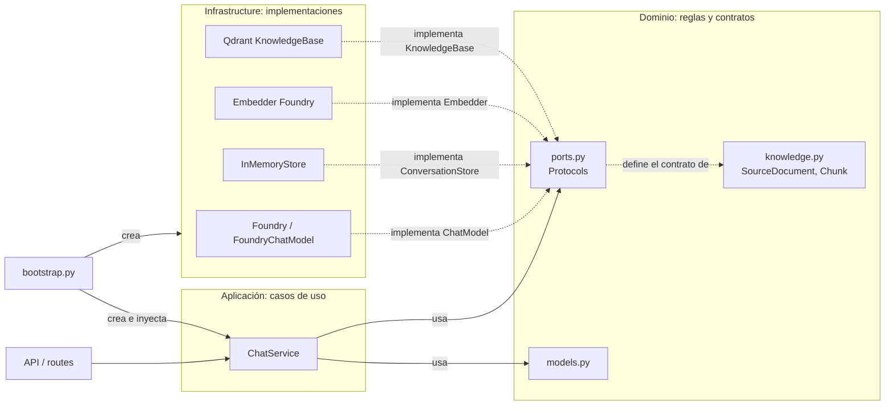

# Aprendizaje S3

## Chunking por sección en un reglamento

**Qué significa:** al trocear (chunkear) un reglamento, no lo cortes cada N caracteres. Hazlo **por sección**, respetando su jerarquía. Así cada fragmento conserva el contexto necesario para entenderse solo:

- **El plazo viaja con su excepción:** si un artículo dice "15 días hábiles" y otro párrafo dice "salvo fraude con tarjeta, 30 días", ambos deben quedar en el mismo chunk. Si se separan, el modelo puede recuperar el plazo sin la excepción y responder mal.
- **El plazo viaja con su título padre:** cada chunk incluye la ruta de encabezados (por ejemplo, "Capítulo 3 > Reclamos > Plazos"). Sin eso, un "15 días" suelto no dice a qué se refiere.

### Ejemplo

Texto original del reglamento:

```
Capítulo 3. Reclamos
  3.2 Operaciones no reconocidas
    Plazo: el cliente tiene 15 días hábiles desde la notificación para presentar el reclamo.
    Excepción: en operaciones con tarjeta clonada, el plazo es de 30 días hábiles.
```

Chunk resultante (sección completa, con su ruta de títulos):

```
Reglamento > Capítulo 3. Reclamos > 3.2 Operaciones no reconocidas > Plazo
Plazo: 15 días hábiles desde la notificación.
Excepción: en operaciones con tarjeta clonada, el plazo es de 30 días hábiles.
```

Chunk incorrecto (corte cada N caracteres):

```
...el cliente tiene 15 días hábiles desde la notificación para presentar el reclamo.
```

El primer chunk responde bien a "¿cuál es el plazo para una tarjeta clonada?". El segundo da el plazo sin la excepción y sin el título que lo ubica.

## Resumen de pyproject.toml
Es el archivo de configuración estándar de un proyecto Python moderno
[pyproject.toml](C:/CAPACITACION_CREDICORP/Codigo_Lab/agent-scratch/pyproject.toml) es el archivo de configuración del proyecto. Define su nombre y versión, las dependencias, cómo se empaqueta y cómo se ejecutan las pruebas.

- **`[project]`**: proyecto `agent` versión `0.1.0`, con Python 3.12 (solo 3.12.x).
- **`dependencies`**: `fastapi` y `uvicorn` (API y servidor), `openai` y `azure-identity` (modelo y autenticación en Azure), `qdrant-client` (base vectorial), `pypdf` y `python-docx` (lectura de PDF y Word), `pydantic-settings` (configuración desde variables de entorno).
- **`[project.scripts]`**: crea el comando `ingest`, que ejecuta `main()` en `agent.infrastructure.ingestion.cli`.
- **`[dependency-groups] dev`**: `pytest` y `httpx`, solo para desarrollo y pruebas.
- **`[tool.pytest.ini_options]`**: pytest busca pruebas en `tests/`.
- **`[build-system]`**: el proyecto se empaqueta con `uv_build`.

QUE SE DEBE REALIZAR LA PAR INGESTA
Instalas las herramientas para leer PDF y Word y la base vectorial, y creas el comando ingest.

pypdf lee texto de PDF y python-docx lee documentos de Word.
qdrant-client es la base vectorial. En modo local corre dentro del mismo proceso de Python y guarda en una carpeta.
Los tres tienen wheels para Alpine y Windows, así que la imagen Docker sigue igual de liviana y no hay nada más que instalar.
[project.scripts] crea el comando uv run ingest.

## El contrato del conocimiento

- **`SourceDocument`**: un documento ya convertido a Markdown, con su metadata (nombre, origen, fecha).
- **`Chunk`**: el fragmento que se indexa y que el RAG recupera al responder. Sus campos coinciden con los del índice `idx-team-NN` de Azure AI Search, así el mismo chunk sirve en local (Qdrant) y en la nube sin transformarlo.
- "Contrato" significa que ambas clases tienen una forma fija acordada.

### SourceDocument, explicado simple

Cada documento llega con una **ficha** (`manifest.json`) que dice de dónde viene, qué tipo es, a qué producto aplica y hasta cuándo sirve. `SourceDocument` es el documento con su ficha pegada, listo para guardarse.

Ejemplo: un reglamento de fraude en PDF con este manifest:

```json
{
  "source": "reglamento_fraude_2026.pdf",
  "doc_type": "reglamento",
  "product": "tarjetas",
  "valid_from": "2026-01-01",
  "valid_until": "2026-12-31"
}
```

Se crea así:

```python
SourceDocument(
    source="reglamento_fraude_2026.pdf",
    doc_type="reglamento",
    product="tarjetas",
    valid_from=date(2026, 1, 1),
    valid_until=date(2026, 12, 31),
    markdown="Capítulo 3. Reclamos...",
)
```

Luego la ingesta corta el texto en chunks y copia estos datos a cada uno, para que el agente sepa de qué documento salió cada fragmento y si sigue vigente.

## Puertos y capas

`ports.py` define **lo que el dominio necesita** del exterior, como interfaces (`Protocol`). Las implementaciones concretas viven en `infrastructure`. Es el patrón de puertos y adaptadores: el dominio define el enchufe y la infraestructura pone el adaptador.

En este repo, los puertos son:

- `ChatModel`: generar respuestas. La implementa Foundry.
- `ConversationStore`: historial por sesión. La implementa la memoria (T1) y más adelante Cosmos DB (T4).
- `Embedder`: convertir texto en vectores. La implementa Foundry con `text-embedding-3-small`.
- `KnowledgeBase`: índice de conocimiento. Qdrant en local (S3) y Azure AI Search después (S5).

Nota: en la explicación anterior usé `ClaimRepository` como ejemplo ilustrativo. **No existe en el repo.** Los puertos reales son los de arriba.



Regla de dependencia: las flechas sólidas apuntan hacia adentro. `infrastructure` depende del dominio, nunca al revés. Así cambiar de Foundry a otro proveedor, o de Qdrant a Azure AI Search, no toca las reglas del negocio.

## Loaders: convertir el corpus a Markdown

[loaders.py](C:/CAPACITACION_CREDICORP/Codigo_Lab/agent-scratch/src/agent/infrastructure/ingestion/loaders.py) es el traductor de formatos de la ingesta. Convierte PDF, Word, HTML, CSV o Markdown en Markdown con títulos `#`, `##` y `###`, que es lo que el chunker necesita para cortar por sección.

1. **`load_corpus`**: lee `manifest.json` y, por cada entrada, convierte su archivo y arma un `SourceDocument`.
2. **`to_markdown`**: elige el conversor según la extensión. Si el formato no está soportado, lanza error.
3. **Conversores:**
   - **Markdown**: se lee tal cual.
   - **CSV**: el nombre del archivo es el título y los datos pasan a una tabla.
   - **HTML**: descarta `nav`, `footer`, `script` y `style`; convierte títulos, párrafos, listas y tablas.
   - **Word**: respeta el orden de párrafos y tablas; los estilos "Título" y "Heading" pasan a encabezados.
   - **PDF**: no trae estilos, así que los títulos se detectan por numeración (`1. Objeto` → `##`, `3.1 Plazo` → `###`).

## El chunker

Parte cada documento Markdown en fragmentos (chunks) que se entienden solos, como fichas de estudio con el título de su capítulo escrito arriba. Es el paso siguiente a los loaders.

1. **Corta por sección**, usando los títulos `#`, `##` y `###`, no por caracteres.
2. **Cada chunk lleva su ruta de títulos**, por ejemplo `Reglamento > Capítulo 3 > 3.2 Plazo`.
3. **El plazo viaja con su excepción**: si ambos están en la misma sección, van en el mismo chunk.
4. **Respeta el tamaño máximo** de `IngestSettings`. Si una sección es muy grande, se divide sin perder su título.
5. **Produce `Chunk`** con los campos del contrato y copia la metadata de `SourceDocument` a cada uno.

Nota: el diseño del chunker es el paso 6 de la guía de ingesta. Su implementación está en [chunker.py](C:/CAPACITACION_CREDICORP/Codigo_Lab/agent-scratch/src/agent/application/chunker.py).

### Implementación en chunker.py

El archivo convierte cada documento Markdown en una lista de `Chunk` en tres pasos:

1. **`_sections`**: recorre el Markdown y agrupa el texto bajo su ruta de títulos, por ejemplo `[Reglamento, 4. Plazos, 4.1 Ampliación]`.
2. **`_split`**: si el bloque es una tabla (empieza con `|`), lo parte con `_split_table` y repite el encabezado en cada trozo. Si es texto, junta párrafos hasta `max_chars`. Si un párrafo no cabe, lo corta por oraciones (`_units`).
3. **`chunk_document`**: arma un `Chunk` por trozo. Pone la ruta de la sección al inicio del `content` y copia `doc_type`, `product`, la vigencia y `source` desde el `SourceDocument`.

El `id` se calcula con `_chunk_id` como **UUID5** a partir de fuente, sección y número de trozo. Es un UUID y no un hash cualquiera porque Qdrant solo acepta números o UUID como `id`.

**Limitación:** si una sola oración supera `max_chars`, no se corta. Queda como un trozo más grande que el límite.

## Embeddings: qué hace y qué cuidar

El embedding es una sola llamada al modelo de Foundry que recibe una lista de textos y devuelve una lista de vectores. Las herramientas de chunking (LangChain, LlamaIndex) solo envuelven esa llamada, así que este proyecto no las necesita.

- **Chunking y embedding son pasos separados.** Cambiar de herramienta de corte no cambia el embedding.
- **La metadata es lo que importa al agente.** `section`, `source`, `valid_from` y `valid_until` sirven para citar la fuente y descartar documentos vencidos. Con otra herramienta, hay que mapear su resultado al `Chunk` del proyecto para conservar esos campos.
- **Si el corpus es difícil, cambia `loaders.py`.** El problema suele estar en la conversión a Markdown. El chunker y el resto del agente no cambian.

Puntos a cuidar:

- **Mismo modelo para documentos y preguntas.** Si se mezclan, la búsqueda devuelve resultados sin sentido y no da error.
- **Dimensión fija.** `text-embedding-3-small` genera vectores de 1536 valores. Cambiar de modelo obliga a recrear el índice y volver a embeber todo el corpus.
- **Lotes y reintentos.** Se envían 16 textos por llamada (`INGEST_BATCH_SIZE`) y el SDK reintenta ante un `429`.
- **No pagar dos veces.** Cada `build` vuelve a embeber todo. Con unos 50 chunks el costo es mínimo, pero con miles conviene guardar un hash del texto junto a su vector y reutilizarlo si el texto no cambió.

## FoundryEmbedder e IngestCorpus

- **`FoundryEmbedder`** usa el mismo endpoint y la misma credencial que el chat, pero con el deployment de embeddings.
- **`IngestCorpus`** chunkea todos los documentos y pide los vectores en lotes de `INGEST_BATCH_SIZE` (16 por defecto): menos llamadas y menos riesgo de `429`.

## Ingesta vs. chat (para junior)

Hay dos momentos distintos.

**Momento 1: Ingesta (se hace una vez, antes de chatear)**

1. Se leen los documentos de fraude y se convierten a Markdown.
2. Se cortan en chunks, cada uno con su título de sección.
3. `FoundryEmbedder` convierte los chunks en vectores. Se envían de 16 en 16: si hay 160 chunks, son 10 llamadas en vez de 160.
4. Se guardan los chunks con sus vectores en Qdrant.

**Momento 2: Cuando preguntas en el chat**

1. Tu pregunta se convierte en vector con `FoundryEmbedder`, la misma conversión que usó la ingesta.
2. Se buscan en Qdrant los chunks cuyos vectores se parecen más al de tu pregunta.
3. Se envían al modelo de chat la pregunta y esos chunks, con la instrucción de responder solo con ellos y citar la sección.
4. El modelo responde, por ejemplo: "Según el reglamento de fraude 2026, sección 3.2 Plazos…".

En el chat los documentos no se vuelven a convertir ni a embeber. Solo la pregunta pasa por el embedder.

**Analogía:** la ingesta es catalogar los libros de una biblioteca una vez. El chat es que el bibliotecario busque los libros del tema y te responda con ellos.

## bootstrap.py: el punto de arranque

[bootstrap.py](C:/CAPACITACION_CREDICORP/Codigo_Lab/agent-scratch/src/agent/infrastructure/bootstrap.py) crea las piezas concretas y las conecta. Es el *composition root*: el único lugar que decide qué implementación usar para cada puerto.

**Ejecución:**

```
uv run uvicorn agent.infrastructure.bootstrap:create_app --factory --reload
```

**Contenido:**

1. **Logs:** configura el nivel INFO.
2. **Constructores de adaptadores:**
   - `build_chat_model` crea `FoundryChatModel` (responde en el chat).
   - `build_embedder` crea `FoundryEmbedder` (convierte textos en vectores).
   - Ambos verifican `FOUNDRY_ENDPOINT` y reciben la credencial de `build_credential`.
3. **`create_app`:** arma `ChatService` con el modelo de chat, el almacén de conversaciones en memoria, el prompt del dominio (`fraud.md`, vía `load_prompt`) y el máximo de turnos. Luego crea FastAPI, registra las rutas y el manejador de `AgentError`.

**Idea clave:** el resto del código solo conoce interfaces (puertos). Cambiar de proveedor o de almacén solo tocaría este archivo.

**Nota:** `create_app` no usa `build_embedder`. El chat no necesita embeddings; probablemente lo usa el módulo de ingesta.

## Qdrant: VectorParams (tamaño y distancia)

[qdrant_knowledge_base.py](C:/CAPACITACION_CREDICORP/Codigo_Lab/agent-scratch/src/agent/infrastructure/search/qdrant_knowledge_base.py) implementa `KnowledgeBase` con Qdrant en modo local: una base vectorial embebida que vive en una carpeta, sin servidor.

Al crear la colección, `VectorParams` fija dos cosas:

- **`size`: cuántos números tiene cada vector.** Se toma de `len(chunks[0].content_vector)`. `text-embedding-3-small` genera **1536** valores. Si cambias de modelo, la colección existente deja de servir: hay que borrarla y volver a ingerir todo.
- **`distance=COSINE`: cómo se mide el parecido.** La similitud del coseno compara la **dirección** de los vectores, no su largo. Dos textos del mismo tema apuntan hacia el mismo lado, aunque tengan longitudes distintas.

Analogía: dos flechas que apuntan al mismo lado son parecidas, aunque una sea más larga. La búsqueda devuelve los chunks cuyas flechas apuntan más parecido a la de tu pregunta. Si el tamaño no coincide, Qdrant da error al guardar o buscar.

## cli.py: el punto de entrada de la ingesta

[cli.py](C:/CAPACITACION_CREDICORP/Codigo_Lab/agent-scratch/src/agent/infrastructure/ingestion/cli.py) tiene dos comandos: `build` y `publish`.

Es como una línea de producción en dos etapas:

1. **`uv run ingest build`**
   - Lee los documentos del corpus (`corpus_dir/<dominio>`).
   - Los corta en chunks con `IngestCorpus.build` usando `chunk_max_chars`.
   - Convierte cada chunk en vector con el embedder de Foundry, en lotes de `batch_size` (16).
   - Guarda el resultado en `data/chunks/<dominio>.json`, un archivo que puedes revisar antes de publicar.
   - Imprime cuántos chunks salieron de cada documento.

2. **`uv run ingest publish`**
   - Lee ese JSON y lo guarda en Qdrant local, en `data/index/<dominio>/`.
   - Imprime cuántos chunks quedaron en el índice.

**Por qué están separados:** `build` es lo caro, porque llama a Foundry para embeber todo. `publish` no llama a la API. Así puedes revisar el JSON o volver a publicar sin pagar otra vez los embeddings.

**Partes del código:**

- `argparse` lee el comando. `--target` solo acepta `local` por ahora; en S5 se agregará `azure_search`.
- `Settings()` lee la configuración desde `.env` y los valores por defecto.
- `build_embedder(settings.foundry)` crea el embedder, igual que en `bootstrap.py`.
- `Counter` cuenta los chunks por fuente solo para el resumen en pantalla.

**Idea clave:** el CLI no tiene lógica de negocio. Solo conecta piezas: cargar, chunkear, embeber, guardar en archivo y publicar en el índice.


